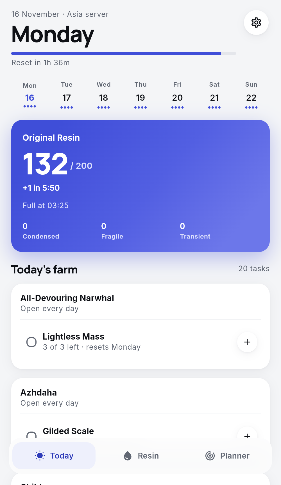
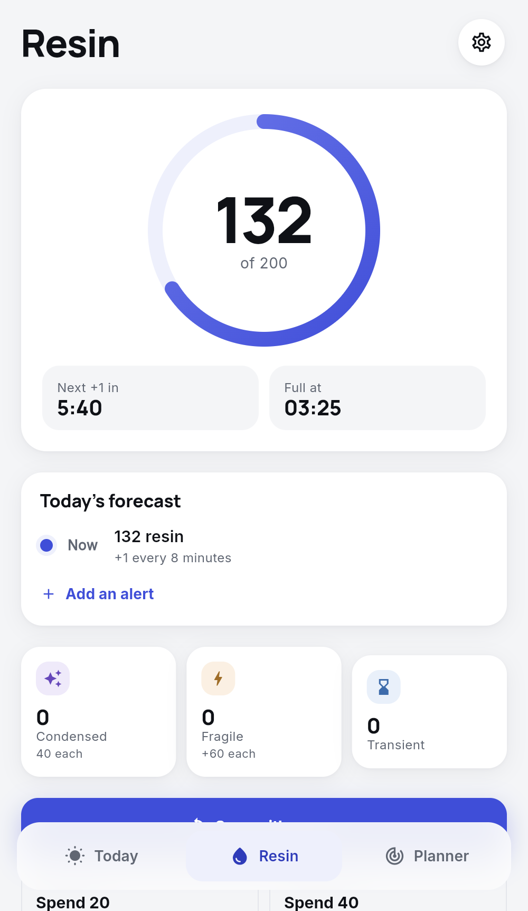
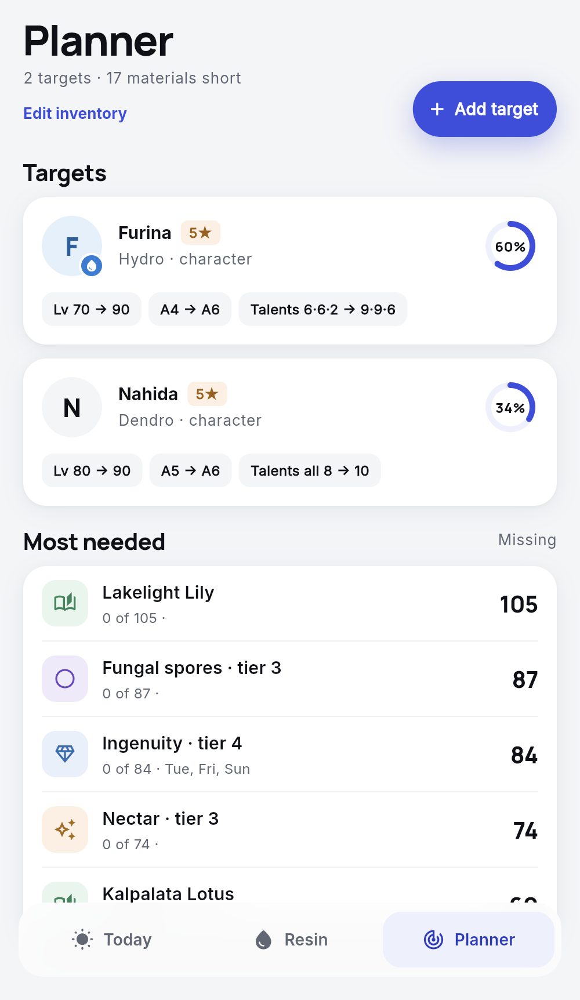
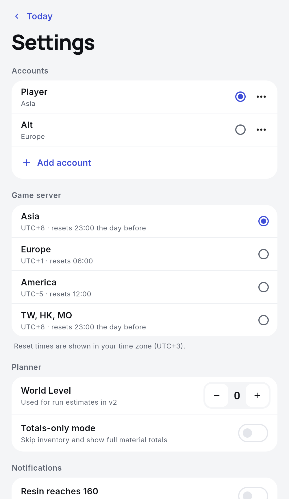

# Routine Planner

[](https://github.com/Mattathiasa/routine-planner/actions/workflows/ci.yml)

Offline-first Flutter companion for a gacha RPG: resin tracker, farming schedule,
daily checklist and material planner. Unofficial, free, no ads. **Not affiliated
with or endorsed by HoYoverse.**

| Today | Resin | Planner | Settings |
| --- | --- | --- | --- |
|  |  |  |  |

A dark theme derived from the same design tokens follows the system setting
([dark screenshots](docs/screenshots/)).

## Features

- **Multiple accounts, side by side** — every local account appears on Today with its
  own resin, daily commission progress, expeditions, weekly boss discounts and realm
  currency; tap a card to switch. Each account carries its **own HoYoLab login**, so two
  real game accounts stay completely separate. Pull to refresh, or let it refresh when the
  app opens.
- **Daily commissions** — live per account when HoYoLab is connected, or tracked manually
  (tap to count 0-4 and claim the bonus) when it isn't, keyed to that account's own server
  day so it rolls over correctly for accounts on different servers.
- **Resin tracker** — anchor-based regen math (never a drifting counter), manual
  sync or opt-in HoYoLab auto-sync, spend/craft/use actions with undo,
  threshold alerts as local notifications for **every** account (exact alarms where
  permitted, labelled approximate otherwise), plus a commission reminder before each
  account's reset. Animated ring and forecast.
- **Today** — server-day aware (per-server reset at 04:00 server time, immune to
  device timezone and DST), open-domain farm checklist with haptic check-off,
  "+1 run" tied to the resin tracker so the two never disagree.
- **Planner** — character/weapon targets with ascension + talent tracking,
  pooled material needs with 3:1 tier-carry aggregation, inventory editing,
  "Most needed" with farm-day availability.
- **Backup** — JSON export/import of all user data.

## Data & assumptions

Game data ships in a read-only catalog built by `dart run tool/build_catalog.dart`
from a vendored, MIT-licensed [genshin-db](https://www.npmjs.com/package/genshin-db)
extract (names, numbers and schedules only — no game art is bundled). The build
is version-stamped (`build/catalog/manifest.json` + the `catalog_metadata` row)
and honours `--scope narrow|full`. The app ships the **full** scope: every playable
character and weapon in the dataset (122 and 256), so you can plan for whoever you
actually own. `--scope narrow` builds the small curated set in
`tool/data/scope_narrow.json` instead, which is handy for quick iteration.

**Every catalog value is community-sourced and unverified in-game.** The full
list of unverified mechanics and data — including the two resin mechanics kept
behind named constants (`ResinEngine.assumedTimerRestartsFromZeroOnReset`,
`ResinEngine.assumedNoRegenerationAboveCap`) and the absent level-EXP ladders —
lives in [docs/ASSUMPTIONS.md](docs/ASSUMPTIONS.md).

Architecture decisions and formulas: [docs/ARCHITECTURE.md](docs/ARCHITECTURE.md).
The HoYoLab connection uses an unofficial endpoint behind an explicit in-app
disclaimer; see the architecture doc before enabling it.

## Getting started

Requires Flutter 3.47 (CI pins 3.47.9).

```sh
flutter pub get
dart run build_runner build --delete-conflicting-outputs   # riverpod/freezed/drift codegen
flutter test                                               # 254 tests, incl. goldens
flutter analyze
flutter run                                                # Android device/emulator, or -d chrome
```

Regenerate the catalog after editing the scope or bumping the dataset:

```sh
bash tool/fetch_catalog_source.sh        # only when bumping the pinned genshin-db version
dart run tool/build_catalog.dart --scope full
```

Golden tests render with the deterministic FlutterTest font but are still
rasterizer-pinned to macOS, so CI excludes the `golden` tag; run them locally
with `flutter test --tags golden`, and after an intentional UI change
regenerate with `flutter test --tags golden --update-goldens`.

The README screenshots come from a demo-seeded web build:
`flutter build web --release --dart-define=DEMO_SEED=true`.

## Release builds

Release signing is read from the environment and never committed:

```sh
export RP_KEYSTORE_PATH=~/keystores/routine_planner.jks
export RP_KEYSTORE_PASSWORD=...
export RP_KEY_ALIAS=routine_planner
export RP_KEY_PASSWORD=...
flutter build apk --release
```

Without these variables the release build falls back to debug signing (not
distributable) so local smoke builds keep working. CI builds an APK artifact on
every push and release-signs it when the `RP_KEYSTORE_BASE64`,
`RP_KEYSTORE_PASSWORD`, `RP_KEY_ALIAS` and `RP_KEY_PASSWORD` repository secrets
are configured (`RP_KEYSTORE_BASE64` is the keystore file base64-encoded).

## Repository map

- `lib/features/*` — feature-first; each `domain/` is pure Dart with an
  injected clock, unit-tested against the formulas in the architecture doc.
- `lib/core/` — clock/server-day, catalog, user database (drift, tested
  migrations), notifications, theme tokens (light + derived dark), navigation.
- `tool/` — catalog pipeline (vendored dataset → generated Dart + sqlite).
- `design/v3/` — approved screen designs (`design/earlier/` was rejected).
- `docs/` — architecture, assumptions, GitHub Pages site (landing, web demo,
  APK downloads).
